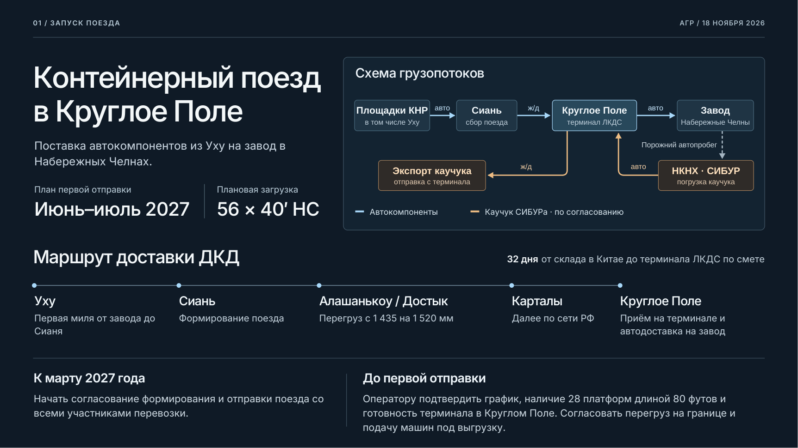
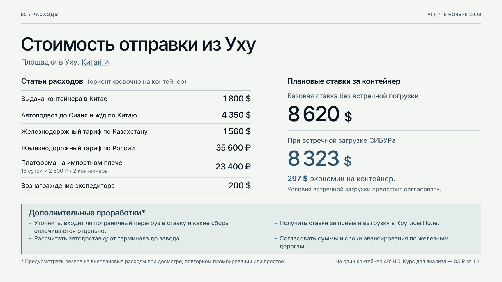

# Контейнерный поезд в Круглое Поле

Поставка автокомпонентов из Уху в Набережные Челны. Первая отправка планируется на июнь–июль 2027 года. Плановая загрузка — 56 контейнеров 40′ HC.

**[Скачать презентацию в PDF](./AGR_Krugloe_Pole_56.pdf?raw=true)** · [Открыть PDF на GitHub](./AGR_Krugloe_Pole_56.pdf)

## Маршрут и запуск

## Стоимость отправки

